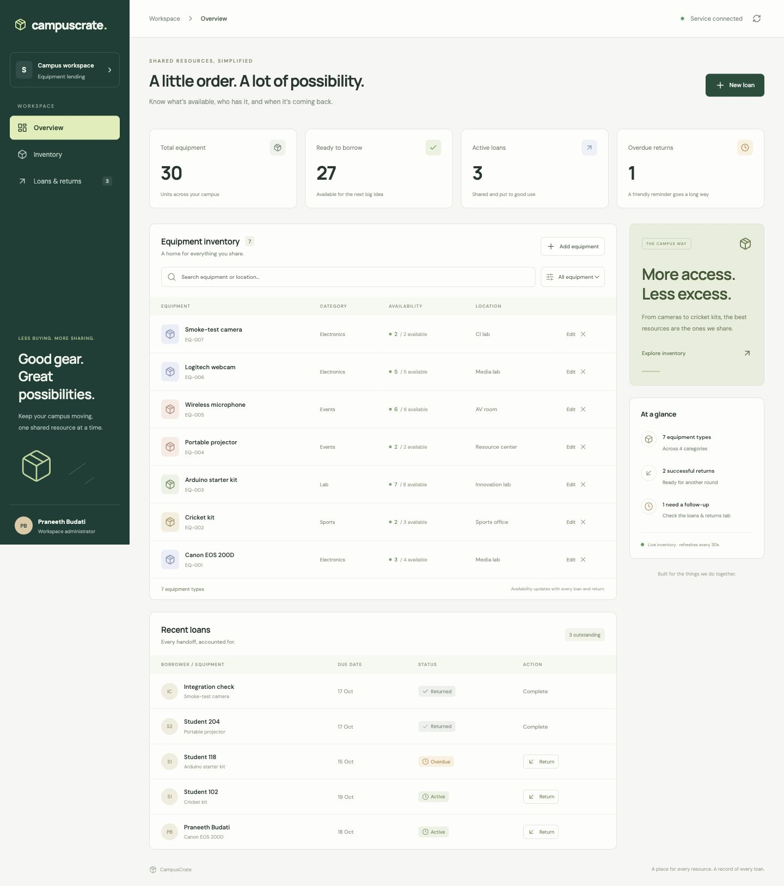
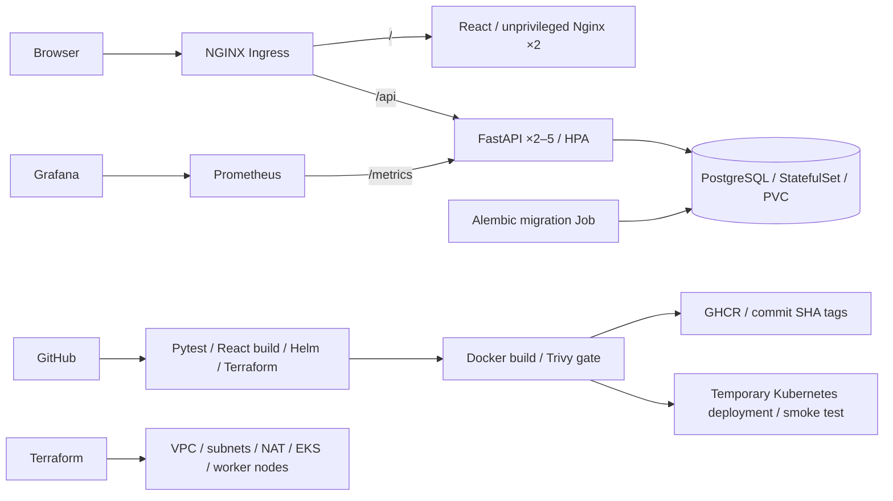

# CampusCrate — campus equipment lending

[](https://github.com/praneethb7/devOps_Assignment/actions/workflows/campuscrate.yml)

CampusCrate is an original equipment inventory and lending application. Students can borrow shared campus resources, administrators can track inventory and due dates, and returned items become available again. It uses React, FastAPI, PostgreSQL, SQLAlchemy and Alembic.



## Application behavior

- Create, search, filter, edit and remove equipment.
- Record one-unit loans with a borrower and a timezone-aware due date.
- Prevent overbooking with a database row lock and a stock check inside the transaction.
- Return equipment, track overdue loans and retain the loan ledger.
- Refuse inventory reductions below outstanding loans and deletion of equipment with loan history.
- Display live totals and refresh every 30 seconds; handle empty, loading and API error states.

## Architecture



CI deploys the exact scanned images to a temporary kind cluster, exercises the application through Nginx and removes that cluster. The persistent demonstration runs on local Minikube. AWS infrastructure is **code only**: no AWS resources were provisioned, no real AWS plan/apply/destroy evidence is claimed. See [validation and limitations](docs/VALIDATION.md).

## Run with Docker Compose

From this directory:

```bash
cp .env.example .env
# Optional: replace the local development password in .env.
docker compose up -d --build
docker compose ps
curl http://127.0.0.1:8001/ready
python3 scripts/smoke.py http://127.0.0.1:3000
```

Open [CampusCrate](http://127.0.0.1:3000) and [Swagger API documentation](http://127.0.0.1:8001/docs). PostgreSQL has no host port. The migration container completes before the backend starts; readiness gates the frontend. Both application images run without root. Port 8001 avoids another application on port 8000. On the development machine an unrelated IPv6 listener answered `localhost:3000`, so the verified URL uses `127.0.0.1`.

Optional sample data (six equipment types, four loans, one overdue):

```bash
docker compose exec backend python -m app.seed
```

Seeding is opt-in and refuses to add data to a nonempty inventory. The smoke test creates a small fixture and retains its completed loan as part of the audit trail. Use a fresh demonstration database if you want only sample data.

```bash
docker compose down       # preserves inventory
docker compose down -v    # deletes this Compose project's database volume
```

## Test and inspect the API

```bash
cd backend
python3 -m venv .venv
. .venv/bin/activate
pip install -r requirements-dev.txt
ruff check .
pytest -v --cov=app --cov-report=term-missing
```

The default tests use isolated in-memory SQLite databases; CI runs the same tests against a dedicated PostgreSQL service via `TEST_DATABASE_URL`. The application database is never used by tests. CI separately exercises migration upgrade, schema-drift detection, downgrade and re-upgrade.

| Method | Path | Purpose |
|---|---|---|
| GET | `/health` | Process liveness |
| GET | `/ready` | Database and schema readiness; 503 on failure |
| GET | `/metrics` | Prometheus request counters and duration histograms |
| GET / POST | `/api/equipment` | List/search or create inventory |
| PUT / DELETE | `/api/equipment/{id}` | Edit or remove inventory |
| GET / POST | `/api/loans` | List or create loans |
| PUT | `/api/loans/{id}/return` | Return one loan |
| GET | `/api/stats` | Availability, active loans and overdue totals |

`201` means a resource was created; `204` means deletion succeeded; `404` means missing; `409` means a business conflict; `422` means invalid input. API documentation is at `/docs` on the backend port. Metrics use route templates rather than raw paths to keep label cardinality bounded.

## Deploy to local Kubernetes

Prerequisites: Docker, Minikube, kubectl, Helm and Python 3. The chart requires explicit image tags and an existing Secret; credentials are generated locally and are never stored in chart values.

```bash
minikube start --driver=docker
minikube addons enable ingress
minikube addons enable metrics-server
docker compose build
minikube image load campuscrate-backend:local campuscrate-frontend:local postgres:17-alpine
bash scripts/bootstrap-secret.sh
helm upgrade --install campuscrate helm/campuscrate -n campuscrate \
  -f helm/campuscrate/values-local.yaml --wait --wait-for-jobs --timeout 5m
kubectl -n campuscrate get pods,svc,ingress,hpa
helm list -n campuscrate
kubectl -n campuscrate exec deployment/backend -- python -m app.seed
```

In another terminal:

```bash
kubectl -n ingress-nginx port-forward svc/ingress-nginx-controller 8088:80
```

Open [CampusCrate through Ingress](http://campuscrate.localhost:8088). Browsers resolve `.localhost` to loopback without a hosts-file edit. For command-line tools that do not resolve it:

```bash
curl --resolve campuscrate.localhost:8088:127.0.0.1 http://campuscrate.localhost:8088/api/stats
HOST_HEADER=campuscrate.localhost python3 scripts/smoke.py http://127.0.0.1:8088
```

The frontend and backend each have ClusterIP Services and at least two replicas. PostgreSQL uses one StatefulSet pod and a 2Gi persistent volume. A migration Job runs per Helm revision, with retries while PostgreSQL starts. Startup/readiness probes keep traffic away until the schema is available. Liveness checks the process independently of the database. PodDisruptionBudgets preserve one available replica during voluntary disruptions.

After rebuilding an image under the local tag, reload it with `minikube image load` and restart the corresponding Deployment. Published images use immutable commit SHA tags instead.

```bash
helm history campuscrate -n campuscrate
helm rollback campuscrate <previous-revision> -n campuscrate --wait
```

A Helm rollback restores workloads, not database contents. Schema changes must remain compatible with the previous application during a rolling deployment; database restores require separate backups.

## Monitoring and autoscaling

See [monitoring setup](monitoring/README.md) for the pinned Prometheus/Grafana installation, dashboard, alert expressions and credential retrieval. [Troubleshooting runbook](troubleshooting/README.md) explains two isolated failure exercises and recovery.

The default backend request is 100m CPU; HPA targets 60%, with 2–5 replicas. For a bounded laptop demonstration, `values-demo.yaml` reduces the request to 20m so modest traffic can cross the target. This is a demonstration setting, not capacity planning.

```bash
helm upgrade campuscrate helm/campuscrate -n campuscrate \
  -f helm/campuscrate/values-local.yaml -f helm/campuscrate/values-demo.yaml \
  --set monitoring.enabled=true --wait --wait-for-jobs
HOST_HEADER=campuscrate.localhost python3 scripts/load.py http://127.0.0.1:8088 180 24
kubectl -n campuscrate get hpa -w
```

Metrics Server must have collected fresh samples; recently started pods can temporarily show `<unknown>`. Prometheus powers dashboards, while Metrics Server supplies the CPU metrics used by HPA.

## CI/CD and security

The workflow lives at the repository root: [campuscrate.yml](../.github/workflows/campuscrate.yml). It triggers on capstone pushes to `main`, pull requests and manual dispatch.

1. Lint, isolated PostgreSQL tests, migration checks, frontend production build, Helm lint and Terraform validation/tests.
2. Build frontend and backend images. Trivy scans OS and application packages for HIGH and CRITICAL vulnerabilities, including unfixed findings; a nonzero exit blocks publication.
3. Publish successful candidates to `ghcr.io/praneethb7/campuscrate-backend:<commit-SHA>` and `ghcr.io/praneethb7/campuscrate-frontend:<commit-SHA>` on branch pushes.
4. Transfer the exact scanned images as short-lived artifacts to a temporary kind cluster. Deploy with Helm, run the lending smoke test, print cluster diagnostics and delete the cluster.

Pull requests build and scan but do not publish. Reports and test results are retained as Actions artifacts. See [security results](docs/SECURITY.md) for actual findings and remediation.

## AWS infrastructure — prepared, not provisioned

```bash
cd terraform
terraform init -backend=false
terraform fmt -check
terraform validate
terraform test
```

Terraform tests use mocked AWS/TLS providers and check the planned two public/two private subnets, two desired workers and private cluster access. They are **not** an AWS provisioning result or a substitute for a real plan.

For a future authorized AWS run, see [AWS runbook](terraform/README.md). No credentials belong in this repository. State, local variable files and saved plans are ignored. The provider lock file is committed for reproducibility.

## Submission and presentation

- [Rubric-to-evidence checklist](docs/SUBMISSION.md)
- [Demo walkthrough and viva notes](docs/DEMO.md)
- [Verification record and limitations](docs/VALIDATION.md)
- [Evidence files](evidence/)

Author: **praneethb7**.
