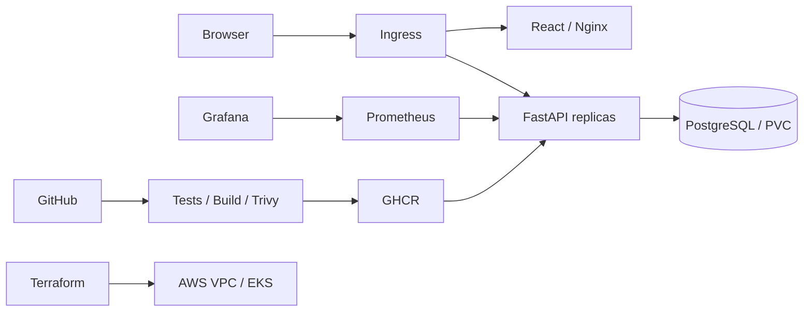

# CampusCrate — Campus equipment lending

CampusCrate tracks shared equipment, student loans, due dates and returns. A React dashboard talks to a FastAPI service backed by PostgreSQL and Alembic migrations.

The capstone covers container delivery, automated testing, security scans, Terraform AWS networking and EKS, Helm deployments, autoscaling and Prometheus/Grafana monitoring.

## Architecture

Implementation and verified run instructions are added with each completed component.
